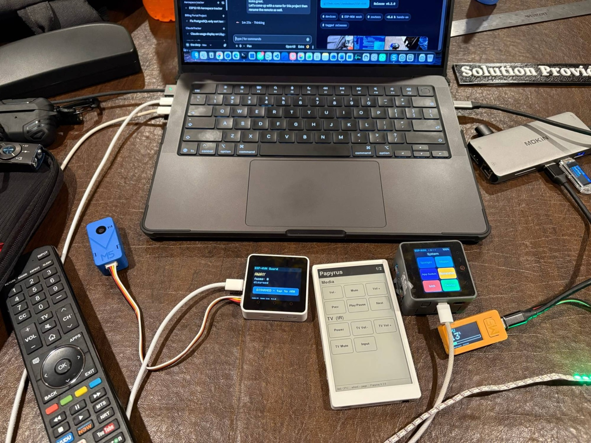

# Nexus

**A six-node wireless control mesh, built from M5Stack gear.** A touch macro deck that types into
your Mac, an e-ink remote that runs the Mac *and* the TV, an AI camera that locks the screen when
you walk away, and an RGB strip that reads your RAM — all talking over ESP-NOW. No router, no cloud.

**[&#9658; Live showcase](https://thededman.github.io/Nexus/)** &nbsp;·&nbsp; [Release v0.2.0](https://github.com/thededman/Nexus/releases/tag/v0.2.0) &nbsp;·&nbsp; [Changelog](CHANGELOG.md) &nbsp;·&nbsp; [Wiring](docs/wiring.md)



> **Scope:** "KVM" here means keyboard + mouse + macros + IR, not video. It controls *your own*
> machines — a productivity/maker tool, not an attack device.

## The mesh

Every device is an ESP32 on **ESP-NOW channel 1**, peer-to-peer. They run on battery and talk
directly — only the keyboard dongle needs the Mac.

| Node | Role | Hardware | Highlight |
|------|------|----------|-----------|
| **Dongle** | USB keyboard/mouse into the Mac + status LCD | LilyGO T-Dongle S3 (ESP32-S3) | USB-HID + ESP-NOW coexist on one S3 |
| **CoreS3 deck** | LVGL touch macro pad (Dev / System / Snippets / Monitor) | M5Stack CoreS3 | also relays Mac stats to the mesh |
| **Slate** | paginated e-ink touch remote (Media / TV-IR / Mac / Monitor) | M5Paper | side-wheel paged; runs the Mac *and* the TV |
| **Guard** | presence-aware auto-lock | M5Stack Core2 + UnitV2 AI camera | no face 15 s → fires ⌃⌘Q |
| **Monitor** | ambient MEM/GPU/CPU/DISK gauge + TV IR blaster | M5StickC Plus2 + SK6812 strip | NeoPixel bar, IR TX on GPIO19 |

## What it does

- **Types anything** — macros, snippets, key combos, and real USB media/volume keys into the Mac.
- **Walk-away lock** — the UnitV2 AI camera sees you leave and locks the screen. No app, no cloud.
- **Ambient monitor** — RAM/CPU/GPU/disk on an RGB strip, switchable from the remote or the stick.
- **TV remote** — tap the e-ink → ESP-NOW → IR blast → the living-room TV powers on (Hisense NEC).
- **All wireless** — ESP-NOW peer-to-peer; everything but the dongle runs on battery.

## Build (PlatformIO)

```bash
pio run                      # compile all five environments
pio run -e dongle            # just the dongle
pio run -e controller        # the CoreS3 deck
pio run -e paper             # Slate (M5Paper remote)
pio run -e core2             # the Core2 UnitV2 guard bridge
pio run -e stickc            # the StickC monitor + IR blaster
pio run -e controller -t upload   # flash the CoreS3 (USB-C)
pio run -e dongle -t upload       # flash the dongle (enter BOOT download mode first)
```

Or open the folder in VS Code with the **PlatformIO IDE** extension for a GUI — same project.

> **Dongle flashing:** the T-Dongle S3 has no auto-reset. Hold **BOOT** while plugging in to flash,
> then **unplug/replug** to run the new firmware. See [docs/wiring.md](docs/wiring.md). The other
> boards flash normally over USB.

## Host monitor

`tools/sysmon.sh /dev/cu.usbmodemXXXX` (the CoreS3's port) streams macOS MEM/GPU/CPU/DISK over
USB serial; the CoreS3 rebroadcasts it to the battery-powered StickC over ESP-NOW.

## Toolchain

Uses the [pioarduino](https://github.com/pioarduino/platform-espressif32) platform fork
(arduino-esp32 3.x), required for ESP32-S3 native USB-HID and M5Unified. Five build environments
share one `platformio.ini` and one ESP-NOW protocol (`lib/espkvm_proto`).

## Status

Public, documented, two tagged releases — see the [CHANGELOG](CHANGELOG.md), the per-device
[wiring notes](docs/wiring.md), and the **[live showcase](https://thededman.github.io/Nexus/)**.
